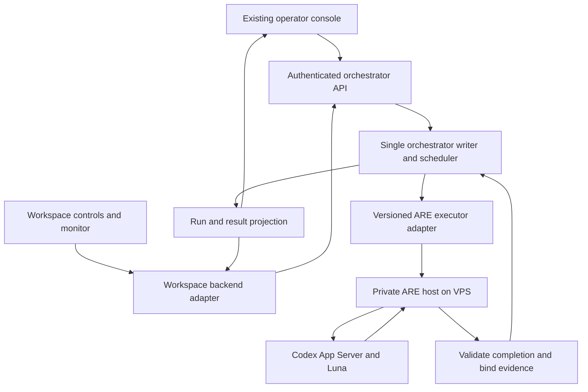

# Orchestrator / Workspace / ARE integration analysis

Date: 2026-09-07. Status: candidate planning evidence. Authority effect: none.
Scope: connect the existing sibling orchestrator to the Workspace and ARE/Luna
pilot. This analysis does not implement, deploy, migrate state, or launch work.
MCP remains last. Open questions are owned below.

## Implementation follow-through — 2026-09-07

The owner-requested next step is now implemented in the sibling checkout:
[one-node fixture adapter and contract](../../../../cya-orquestrator/cyberAlchemy-v2/work-orchestration-implementation/docs/are-text-executor.md).
[Exact test evidence](../../../../cya-orquestrator/cyberAlchemy-v2/work-orchestration-implementation/docs/are-text-fixture-evidence.json)
records 55 passing tests, zero provider calls and no deployment. The actual
supervisor accepts a fixture-backed receipt/event and verifies restart replay;
interrupted dispatch remains blocking. Native ARE completion is not claimed.
That subsequent native transport stage has also passed:
[NATIVE-TRANSPORT-PLAN.md](NATIVE-TRANSPORT-PLAN.md). The current frontier is
console/backend integration, with VPS activation still separate.
The analysis below retains its original observation-time scope.

## Recommendation

Keep the orchestrator as the owner of runs, scheduling, leases and accepted
history. Add an explicit ARE/Codex executor for a bounded node contract. Reuse
the existing operator console for run controls and expose the same backend to
Workspace. Keep ARE responsible for request reasoning, effect boundaries and
native completion verification. Preserve both evidence chains and connect
them by exact identities.

The initial integration should execute one supplied-text node, with one model
call, no tools and no automatic retry. General research DAGs follow only after
their structured-output, evidence and budget contracts work through ARE.

## Evidence inspected

The user-cited checkout resolves to `../cya-orquestrator` (that spelling).
Its operative package is
[work-orchestration-implementation](../../../../cya-orquestrator/cyberAlchemy-v2/work-orchestration-implementation/README.md).
The sibling HEAD was `c71e923c`; its operative package had no reported Git
changes during inspection. The VPS image is `cyberalchemy-orchestrator:9de7de67`.
These are different version references: current source behavior is not proof
that every feature is present in the deployed image.

Read-only VPS checks found:

- Existing orchestrator running, unchanged start time
  `2026-09-04T12:45:35.760040948Z`.
- Public host `https://orchestrator.cyberalchemylab.com/` responded HTTP 401.
  This proves an authentication challenge, not a successful authenticated
  browser journey. Its Basic Auth login is separate from the local bridge token.
- VPS loopback `18080/api/v1/state` returned
  `cav2-orchestrator-current-state/v1-candidate`: three closed runs, including
  two Luna runs with six nodes each. Capacity reported zero active and four
  available slots. These are point-in-time observations.
- The actual Workspace `projectWorkers` function successfully parsed that live
  snapshot: 12 Luna node records, one executor, zero ARE evidence records.
- VPS loopback 18082 returned the separate one-run RWO/ARE pilot projection.
- No model calls, run mutations, service restarts or credential changes were
  performed for this analysis. Full test suites were not rerun.

Primary implementation sources:

- [HTTP service and inline scheduler](../../../../cya-orquestrator/cyberAlchemy-v2/work-orchestration-implementation/runtime/src/bin/orchestrator_web.rs)
  (`route`, `advance_assignment`, `invoke_provider_task`, `state_projection`).
- [Worker protocol](../../../../cya-orquestrator/cyberAlchemy-v2/work-orchestration-implementation/worker-protocol/README.md),
  [transaction owner](../../../../cya-orquestrator/cyberAlchemy-v2/work-orchestration-implementation/runtime/src/transaction.rs),
  [supervisor](../../../../cya-orquestrator/cyberAlchemy-v2/work-orchestration-implementation/runtime/src/supervisor.rs).
- [Direct provider worker](../../../../cya-orquestrator/cyberAlchemy-v2/work-orchestration-implementation/runtime/openai_luna_worker.py).
- [Console](../../../../cya-orquestrator/cyberAlchemy-v2/work-orchestration-implementation/frontend/README.md),
  [browser API](../../../../cya-orquestrator/cyberAlchemy-v2/work-orchestration-implementation/frontend/src/api.ts),
  [frontend mode selection](../../../../cya-orquestrator/cyberAlchemy-v2/work-orchestration-implementation/frontend/src/App.tsx).
- [VPS envelope](../../../../cya-orquestrator/cyberAlchemy-v2/work-orchestration-implementation/deployment/vps/docker-compose.yml).
- [Existing pilot operating contract](runtime/WORKSPACE-LAUNCH.md),
  [task contract](runtime/task-contract.mjs), [bridge](runtime/workspace-task-bridge.mjs),
  [native host](runtime/pilot-host.mjs), [pilot RWO adapter](runtime/rwo/adapter.mjs),
  [kernel source binding](runtime/rwo/source-binding.json).
- [Workspace monitor](../../runtime/src/features/control-center/LunaWorkers.tsx),
  [projection parser](../../runtime/src/features/control-center/workers.ts).

## What already exists, and what is disconnected

| Concern | Orchestrator | Current Workspace pilot |
|---|---|---|
| UI | Full React/Vite console: Runs, Results, Operations, Lab, Ontologies | TaskLauncher component preview on local 18085; full Workspace build not validated |
| Controls | Same-origin run creation, strategy proposal/approval, pause/resume, manual advance | Bearer-authenticated review and launch on local 18084 |
| Scheduler | Durable run supervisor, leases/fences, command receipts, bounded capacity | One task at a time; small lifetime budget; per-task staging over SSH |
| Execution | Python subprocess calls OpenAI Responses directly | ARE wrapper/hooks → Codex App Server → Luna |
| Output | Structured research output, provider evidence, audit and closeout paths | Bounded nonempty plain text, 512 output tokens, no tools |
| Recovery | Request transaction replay, command reconciliation, unknown-effect handling | Intent persisted before dispatch; uncertain outcomes stop execution; offline replay |
| State | One accepted-history owner per orchestrator run | Independent bridge journal, pilot RWO stream and ARE/native journals |

The pilot already uses an exact source-bound RWO kernel vendored in the sibling.
That code reuse does not connect it to the deployed supervisor, its manifests,
leases, command receipts or accepted history.

`AGENTS.md` instructs repository agents to consult ARE. It does not intercept
the orchestrator's Rust/Python execution path. Runtime integration must call
ARE explicitly; an instruction-file change alone cannot establish it.

## Proposed ownership and transport

Use the current web service's serialized `OrchestratorService` ownership for
the first integration. Do not start a second `orchestratord` against its state
volume: the web service already owns that service in process. A later split
to the Unix-socket daemon is an alternative architecture requiring an explicit
single-writer transition, not a prerequisite for the first node.

Prefer a narrow Unix-socket ARE host interface shared with the container, with
explicit filesystem permissions, protocol version and peer/access policy.
The host controls preinstalled candidate paths, credentials and task workspaces.
The container must not receive root SSH access or a general systemd/Docker
control socket. Its `127.0.0.1` is not the VPS host's loopback namespace.
Private authenticated HTTP is an alternative if socket deployment proves
unsuitable, but it is additional transport work.

ARE host journals remain execution evidence. The orchestrator journal remains
the accepted-history owner. Do not copy pilot `history.json` into an orchestrator
run or nest its scheduler as another owner for the same command. Reuse host
execution and verification code below the pilot's independent RWO adapter.

## Required contract changes

1. **Select a versioned executor contract.** Add a candidate contract such as
   `are-codex-text/v1` to the source-owned node/manifest/compiler path. Bind
   executor identity/version and do not silently replace `openai-responses/v1`.
   Update dispatch, budget accounting, receipts and result projection together.
   The current web dispatch treats non-provider/non-closeout contracts as demo
   work; an ARE contract must have an explicit branch and unknown contracts
   must fail before being treated as successful no-effect work.
2. **Bind the assignment.** Carry run key, graph/manifest digest, node ID,
   command ID, attempt, lease/fencing token, request ID, task/input digest,
   objective posture, candidate/profile digests, deadline, tool policy and
   budget. Derive a stable host attempt ID from these fields. The existing
   text-task schema is closed and cannot simply accept arbitrary new fields;
   use a separately versioned executor envelope.
3. **Bind reasoning without rewriting user intent.** Preserve raw instruction,
   declared objective and inferred postures; dependency text is data. Require
   real route/context and applicable effect/completion decisions. The present
   pilot only admits `understand`; implementing, researching with tools or
   adopting arbitrary existing sessions is outside that contract.
4. **Bind results.** Validate exact assignment/task identity, native thread and
   turn, completion binding, output hash, execution status, measured provider
   usage and effect disposition. Persist evidence before submitting the fenced
   orchestrator receipt and node event. Native completion, accepted node event,
   DAG closeout and owner acceptance remain distinct states.
5. **Make retries and uncertainty explicit.** Repeated identical requests return
   the recorded outcome; conflicting bytes fail. Timeout after delivery is
   unknown, not safe-to-retry. Recovery queries existing host evidence and
   reconciles through the orchestrator owner. A provider call that happened
   still counts if subsequent validation fails. Do not promise exactly-once
   external execution from local request deduplication.
6. **Align lease and cancellation behavior.** Renew fences during native
   execution; stop submission after lease loss. Pause prevents future dispatch
   and is not cancellation of an active provider call. Define interrupt/kill,
   shutdown and reconciliation behavior explicitly. Current pilot socket and
   SSH timeouts differ from web worker/lease timeouts; configure one tested
   deadline hierarchy rather than inheriting those defaults.
7. **Expand research separately.** The existing Python worker returns structured
   JSON and provider retrieval evidence. A plain-text ARE result cannot satisfy
   the research artifact/auditor pipeline. Add schema validation, bounded
   dependency materialization, citation/evidence preservation and semantic audit
   integration before selecting ARE for those nodes. Web retrieval requires its
   separate authority and budget; keep it disabled for the first vertical.
8. **Account for the planner.** Strategy proposal generation also invokes the
   provider and has a repair path. Replacing node execution alone leaves planning
   outside ARE. Decide and label that scope, then integrate planner reasoning
   separately if the objective is for all inference to pass through ARE.

## Frontend and access work

The fastest complete run UI is the existing orchestrator console. Extend it
with explicit executor identity, ARE readiness, pending/blocked reasons, the
reviewed budget and completion evidence. Preserve its run and Result journeys.

Workspace can consume the same backend through a typed adapter. Read projection
compatibility has passed, but browser integration has not: `workerEndpoint`
currently accepts only loopback HTTP and `LunaWorkers` omits credentials. The
console API uses same-origin credentials, exact Origin and intent headers;
Traefik provides Basic Auth. The bridge token authenticates neither that console
nor its API. A plain SSH port forward does not supply browser CORS permission.

Use an authenticated backend connection or a same-origin deployment for
Workspace, with narrowly allow-listed read/control operations. Do not expose
the pilot bridge publicly or add wildcard CORS. Do not embed provider keys or
Basic Auth credentials in JavaScript. Maintain one explicit operator identity
and authorization mapping when a backend adapter performs controls.

For local development, replace the console's hostname-derived fixture choice
with explicit live/fixture configuration and a tested local proxy arrangement.
Currently `localhost` and `127.0.0.1` deliberately render fixture data, even if
a backend exists. Full Workspace and packaged Tauri origins need their own
browser/native tests; a working TaskLauncher preview does not prove them.

## Ordered implementation and acceptance plan

| Stage | Runnable product work / owner | Exit evidence |
|---|---|---|
| 1 | Integration owner: freeze selected orchestrator source, ARE candidate and one-node contract | Manifest, source digests, identity mapping, budgets and failure table reviewed |
| 2 | Orchestrator owner: add executor dispatch and fixture host | One node reaches a receipt-backed result; no provider calls; unsupported executor rejected |
| 3 | ARE owner: implement private host envelope, status/recovery and fenced completion adapter | Native fixture pass; crash/replay and stale-worker tests pass |
| 4 | Frontend owner: expose executor/result in console; connect Workspace via typed backend adapter | Actual browser auth, review, dispatch and result journey; fixture/live distinction verified |
| 5 | Operator plus runtime owners: validate exact VPS candidate in isolated state, then selected live canary | One budgeted model call, recorded native and orchestrator evidence, zero-call replay; old service remains unaffected |
| 6 | Research owner: structured outputs, dependency/evidence/audit contracts and planner scope | Existing research fixtures pass through selected executor without changing evidence meaning |
| 7 | Runtime owners: bounded concurrency and recovery operations | Capacity/fencing/cancellation tests under load, operator reconciliation procedure |
| 8 | Integration owner: MCP transport, if still needed | Same tested executor contracts and authority boundaries reused |

Critical tests include duplicate dispatch before/after host delivery; restart
after begin, after inference, after receipt and before event; stale fence;
changed task/profile/source digest; corrupt evidence; route rejection before
provider use; output-limit/schema failure after use; host unavailable; unknown
delivery; cancellation; lease renewal; pool saturation; replay with zero calls;
and wrong-origin, unauthenticated, expired-review and stale-result browser cases.
Retain the sibling's supervisor, transaction, durable-controller, worker-protocol,
research and frontend regressions. Run native builds through this checkout's
`tools/toolchain/run`, preserving nested pins. The local launcher is not a
portable Ubuntu 24.04 build guarantee: validate target ABI/ICU and binary hashes
for the VPS artifact separately.

## Construction frontier and operational support

Current product frontier: candidate integration contract and one-node fixture
adapter. Its source analysis is complete; implementation is not started by
this request. No target ontology record/selector is required for this read-only
comparison. Any later construction binding must name its exact dependencies.
Carry forward the D65 definition → capability → business ontology → DomainSpec
→ compiled graph → system ontology → implementation → exact candidate tests
→ product review chain without treating this document as admission.

| Operational task | Owner | Affected stage | Blocking basis |
|---|---|---|---|
| Select deployable source revision and build manifest | Runtime owners | VPS candidate | Source HEAD differs from deployed image; byte equivalence unverified |
| Socket mount, UID/GID policy, persistent journals and service lifecycle | Operator | VPS candidate | Current container cannot reach the private host contract as proposed |
| Credential provisioning after reboot | Operator | Live canary | Existing runtime credential copy is under ephemeral `/run` |
| Native host capacity and memory measurement | Runtime owner | Concurrency stage | Four direct-provider slots do not prove four Codex hosts fit the VPS |
| Backup, rollback and in-flight reconciliation | Operator | Any shared-state migration | Preserve accepted histories; no dual writers or automatic uncertain retries |
| Exact tested-product review and deployment selection | Product/runtime owner | Operational activation | Candidate planning and passing tests alone do not authorize cutover |
| Shared authentication, public Workspace hosting, MCP | Respective owners | Later deployment/transport stages | Deferred; not blockers for the one-node fixture |

## Open Questions

- Should the existing console be the first complete user-facing integration,
  with Workspace consuming the same backend? Recommended default: yes.
- Is ARE required for node execution first, or also strategy proposal/repair?
  Recommended first scope: one typed node, with planner scope displayed honestly.
- Which exact orchestrator revision should be frozen against the installed ARE
  candidate? The inspected local source and deployed image must not be conflated.
- Which owner-controlled host interface should provision per-task native hosts
  without giving the web container general host administration privileges?
- What identities and immutable evidence references bridge native completion to
  orchestrator receipt acceptance, including after an interrupted submission?
- What is the selected operator reconciliation procedure for a consumed model
  budget with missing/invalid output or lost delivery acknowledgement?
- Which structured-output/evidence contract and budgets are accepted before
  migrating research nodes, planner inference, tool use or multi-turn sessions?
