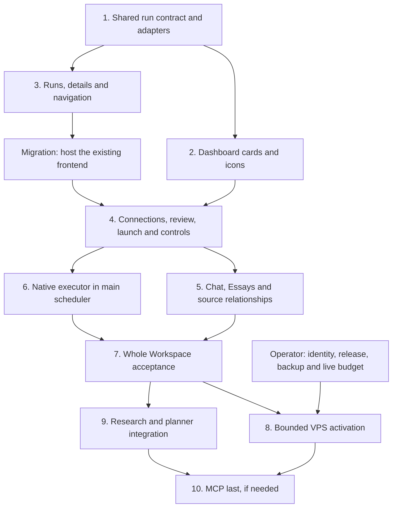

# Workspace orchestration integration DAG

Status: candidate plan, owner-requested 2026-09-07. Authority effect: none.
Machine graph: [DAG.json](DAG.json). This is a construction work graph, not an
admitted runtime execution DAG. Scheduling this plan does not execute its tasks.



## Product construction

T7 is in progress under the [acceptance sub-DAG](T7-ACCEPTANCE.md). T7A passes the broad isolated browser regression. T7B passes the unchanged browser budgets after correcting a stale editor timing interval (3.0 ms p95 across 125 inputs). T7C passes the complete native journey and all 13 unchanged budgets in the explicitly bounded software-composited Xvfb fixture; accelerated-Xvfb failures remain retained as environmental evidence. T7D passes Chromium, Firefox and WebKit at both widths, zero axe violations across 12 states, and a representative real Orca speech-output journey. T7E acceptance closeout is next; broader manual assistive-technology scope and live ontology integration remain explicit release decisions.

T1–T6 and the M1 frontend migration are complete within the local fixture candidate boundary. [T5E acceptance](T5E-ACCEPTANCE.md) covers three source-to-run-to-Essays journeys and native owner replay. T6 (native main-scheduler integration) is complete within isolated fixture acceptance: [T6A](T6-NATIVE-SCHEDULER.md) selects contracts before leases, and [T6B](T6B-COORDINATOR.md) supplies the capacity-holding native coordinator. [T6C1](T6C-REGISTRATION.md) adds immutable reviewed registration; [T6C2](T6C2-RECOVERY.md) restores startup reservations; [T6C3](T6C3-INTEGRATION.md) connects the shared scheduler and dashboard controls; [T6D](T6D-ACCEPTANCE.md) passed four real native scenarios. T7 whole-Workspace acceptance is next. T1's exact scope was a non-executing versioned run view and
source adapters, tested against a copy of existing native history. Runtime
instance identity, launch identity, owner run key, execution status, freshness,
fixture/live mode and verification remain separate. Missing metadata is reported,
not guessed. T2/T3 will consume this contract; they are not included in T1.

[Task 1 evidence](T1-EVIDENCE.json) records 16 adapter/DAG checks, five native
regressions and strict targeted TypeScript checking. The [existing-task check](EXISTING-HISTORY-EVIDENCE.json)
replayed a private copy and resolved the actual owner run key. Original history,
launch records and four remaining fixture launches were preserved. The running
UI is unchanged; dashboard wiring is T2.

Reuse Workspace as the product shell, extract reusable sibling run views, and
keep one history writer per run. Existing native tasks can be projected without
moving their journals into the main scheduler. Foundation/Ontology retain their
source owners; execution relationships are a runtime projection. Essays output
uses its existing staging and saved-draft workflow.

The D65 chain is carried from the [router construction contract](../../../agent-routing/ROUTER.md#d65-construction)
and the [native console candidate](../luna-vps/NATIVE-CONSOLE-PLAN.md). T1 adds no
ontology record/selector prerequisite and grants no admission, deployment or
publication. Goals validation is not claimed by this standalone candidate DAG.

## Operational support

O1–O3 in DAG.json name operational owners and the exact affected stage, T8.
They do not block local projection, dashboard or fixture construction. Production
state migration and broader provider effects remain separately selected work.
The existing local console, journals, remaining budget and pinned driver are
preserved during T1. No task is dispatched for adapter validation.

## Open Questions

- Which authenticated multi-runtime catalog should VPS activation use? T4 uses
  one explicitly configured local native runtime ID and does not infer connections.
- Which cross-feature context is allowed to leave its owning feature?
- Which operator reconciliation resolves interrupted runs without automatic retry?
- Which exact VPS build and live budget should T8 activate?

## T2 dashboard candidate

T2 adds Dashboard to the full Workspace shell, with live native-run cards,
work-type icons, execution/mode badges and result deep links. The read adapter
uses the T1 contract and verifies completed owner history on private copies.
The same card survives result navigation, refresh, source outage and reconnect.
The existing native console remains the task launcher until T4.

Open: **http://127.0.0.1:4187/#/dashboard**. No token entry is required on this
local read-only dashboard. `ca2-workspace-dashboard.service` starts with the
Linux user session. Restart with:

```sh
systemctl --user restart ca2-workspace-dashboard.service
```

The service publishes the full Workspace build on the same origin as
`GET /api/v1/workspace/runs`; it rejects writes and unexpected Host headers.
It currently reads the configured local native source. The T1 legacy
orchestrator adapter is available for later connection wiring, but this service
does not claim to aggregate the VPS yet. Backend replay caches are invalidated
by source-history and result changes. Failures retain last known observations
marked offline, and current active counts become unavailable.

### Build and validation boundary

The standard `npm run build` failed at `WORKSPACE_CATALOG_SNAPSHOT_DRIFT` in
`build-workspace-snapshot.mjs`. Its baseline and expected digests were not changed.
Dashboard construction has no ontology catalog admission dependency under the
selected route. The separate candidate command
`node workspace/plans/orchestrator-integration/build-dashboard.mjs` runs full
Workspace TypeScript checking and bundles the existing reference snapshots to
`workspace/runtime/dist-dashboard`. It checks their bytes remain unchanged and
records hashes in `dashboard-build.json`. Explore labels its bundled snapshot.
This is not successful regeneration or freshness admission of those references.

The browser dashboard acceptance covers the actual existing task, owner replay,
icons, result links, reload, Explore navigation, mobile overflow, source failure
and recovery, and rejected writes/hosts. The legacy all-feature browser script
was also attempted: navigation was updated for Dashboard and the explicit
Workspace graph, but it still fails its old web-chat alert expectation. T2 does
not claim whole-Workspace browser/Tauri acceptance, current ontology-v4 service
availability, or measured compliance with all performance budgets. Those remain
T7 work; the dashboard stays lazy-loaded and adds approximately 7 kB of JS before
gzip. Browser mode still cannot provide the Tauri Chat/host bridges.

Installed build and driver: `~/.local/share/are-workspace/dashboard-01/`.
Operator configuration: `~/.local/state/are-workspace/dashboard-01/config.json`.
Source implementation: [dashboard-server.mjs](dashboard-server.mjs).
Exact evidence is in [T2-EVIDENCE.json](T2-EVIDENCE.json). Open questions remain
owned by the section above; source-binding repair and legacy acceptance updates
are additional prerequisites for whole-product acceptance.


## T3 shared Runs candidate

The local Workspace now has one shared polling provider for Dashboard and Runs,
a searchable Runs index with status filters, and full recorded run details.
Both surfaces link to the same stable view identity. Details show the result,
executor, progress, lifecycle observations, source freshness and identity evidence.
Existing dashboard result links remain valid. Unreported traces, graphs, workers
and origins remain explicit; no lifecycle action is inferred from completion.

Open [Runs](http://127.0.0.1:4187/#/runs) or use the Runs navigation icon.
The mobile rail gives all seven feature buttons its full width. The installed
local candidate was refreshed and restarted; the previous assets are retained
under the dashboard installation for rollback.

[Task 3 evidence](T3-EVIDENCE.json) records 53 targeted checks, full TypeScript
and candidate bundling, real browser search/filter/detail/reload/legacy-link
and offline recovery checks, and installed navigation at 320px.
One poller serves both mounted views. Original task records and the four remaining
fixture launches are unchanged; no model call was dispatched.

This retains T2's build boundary: bundled reference snapshots, no regeneration
or admission claim. Standard snapshot drift, the older Chat browser assertion,
and full Tauri/performance acceptance remain visible T7 residue.
T4 is the next product frontier; O1–O3 still affect T8 only.


## M1 — integrate the existing frontend

The owner's correction supersedes the parallel Workspace Runs interface.
The orchestrator remains part of Workspace while its source stays in the
separate cya-orquestrator repository. Its package now exports an embedded
entry using the same Runs list, seven detail tabs, Operations, Research Lab
and Ontologies components as its standalone application.

Workspace provides a [frontend host and registry](../../runtime/src/frontends/README.md):
a linked package, an adapter and a registration add an external frontend without
new feature branches in the shell. Styles are isolated inside a shadow root;
React context and the shared run provider cross the portal. Trusted application
code still shares the JavaScript environment. Navigation uses
#/apps/orchestrator/runs and related routes; historical links remain valid.

The duplicate RunsSurface was removed. The native observation adapter preserves
execution status, mode, freshness, verification and identities. It does not invent
research strategy, worker assignments or lifecycle decisions. Lab reference
personas and concepts remain the sibling's bundled catalog.

[Migration evidence](M1-EVIDENCE.json) records both builds, targeted tests,
browser navigation through the existing views, mobile styling isolation,
and an installed smoke check. Original native records and four remaining
fixture launches were preserved. No launch or model request was made.

T4 must wire the existing composer and controls through explicit runtime services.
The current source supplies only local native observations; delivery of richer
orchestrator projections is part of that connection work. Existing built-in
Workspace features may adopt the generic host incrementally.
T2's snapshot build limitation and T7 acceptance residue remain unchanged.


## T4 — existing editor and native controls

The existing sibling NativeTasks component now accepts host services. Workspace
passes its shared native state, backend-advertised capabilities and request/refresh
callbacks. The editor is reused for Runs → New run, review and launch; its embedded
mode omits the duplicate history panel. Launch opens the same stable view used by
Dashboard. Active run details expose cancellation only when advertised by the
backend. Editing reviewed material invalidates that review in the editor.

The [native control gateway](native-controls.mjs) forwards only review, launch and
cancellation to the selected native console. Exact Origin, content type, intent
header, runtime ID and request shape are checked. Failed or stale observations
remove controls. The native console remains the one state writer and enforces
review digest/expiry, capacity, uncertainty, duplicate review retries and budget.
Workspace has no new launch ledger and does not manufacture pause/resume actions.
Successful controls wait for prior observations before the shared provider reloads.

The installed dashboard config explicitly sets controls_enabled to true for
local-native-console-01; the default is false. Existing frontend assets and config
are retained as frontend-before-t4 and config-before-t4.json for rollback.
The native console's driver, bindings, histories and budget are untouched.

[Test evidence](T4-EVIDENCE.json) records 63 targeted checks, both frontend builds,
a real isolated browser/owner fixture canary with completion and cancellation,
duplicate retry and restart checks, offline/budget rejection, the prior embedded
interface regression suite, and installed editor/reload inspection.
No installed launch was consumed; four remain. No paid model call was made.

This completes the selected native fixture connection. Full research projections,
the research planner, and scheduler pause/resume remain dependent on T6 and the
selected runtime/VPS stage; they are not inferred from a native fixture connection.
T5 and T6 are the next runnable product work. MCP remains last, and T7's broader
acceptance residue is unchanged.


## Strategy graph and Overview repair

Run details now open on Overview, which is the first tab. The existing strategy
graph renders at the top of Overview and remains available on Strategy.
Completion updates no longer switch the selected tab to Result.

The Workspace projection now preserves validated source strategy graphs.
For native tasks, the backend reads the registered run manifest and checks its
identity, task binding and canonical graph digest against the run registry.
Preparing tasks without a registered manifest remain explicitly unavailable.
Current native fixture manifests contain one text-worker node; no research
strategy or persona assignment is synthesized. Legacy model-only descriptors
remain compatible without pretending to contain a graph.

[Repair evidence](GRAPH-EVIDENCE.json) records both builds, 42 targeted tests,
browser graph/default-tab/reload checks against the two existing completed tasks,
and the installed smoke check. No task was dispatched and the three remaining
fixture launches were preserved. T5 and T6 remain the next product frontier.

## Conditional graph and UX audit — 2026-09-08

Implemented topology-dependent strategy presentation in the existing sibling frontend: one step or independent steps use a compact list; declared multi-node dependencies retain the graph. Overview stays first/default. [UX-AUDIT.md](UX-AUDIT.md) records rendered accessibility, UX and UI findings, evidence and limits. [UX-DAG.json](UX-DAG.json) proposes the repair sequence; UX2 readability/semantics is the next recommendation, with UX3 focus/recovery independently runnable. [UX-EVIDENCE.json](UX-EVIDENCE.json) records passing bounded tests and preserved native history/budget. Wider audit repairs remain proposed; parent T5/T6 and operational gates are unchanged. Open questions are owned by the audit.

## UX2 readability and semantics — 2026-09-08

[UX2-READABILITY.md](UX2-READABILITY.md) records the implementation and verification plan. Shared readable type tokens, corrected contrast, native run links/list structure, keyboard persona disclosures, worker table roles and the Workspace brand role are implemented. [UX2-EVIDENCE.json](UX2-EVIDENCE.json) owns results. UX3 focus/recovery is the next UX frontier; UX4 remains independently runnable. Parent integration T5/T6 and operational stages are unchanged. Open questions remain with the UX2 record and parent audit.

## UX3 focus and recovery — 2026-09-08

[UX3-FOCUS-RECOVERY.md](UX3-FOCUS-RECOVERY.md) records the plan and implementation: active-route heading focus, loading/skip semantics, guarded focusable controls, associated validation errors, timed review expiry, retry handling, offline draft retention and uncertain-launch recovery. [UX3-EVIDENCE.json](UX3-EVIDENCE.json) owns results. UX4 is the next UX frontier; parent T5/T6 and operational stages remain unchanged. Open questions are owned by the UX3 record and parent audit.
